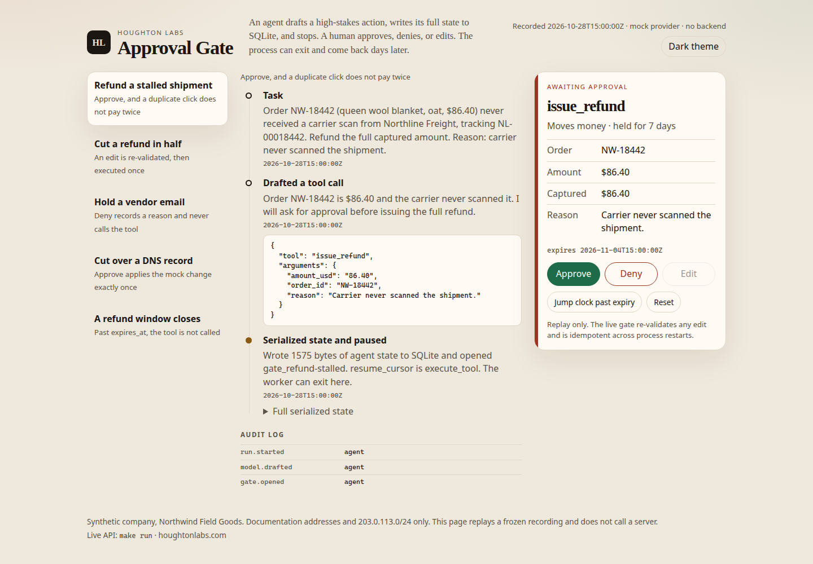
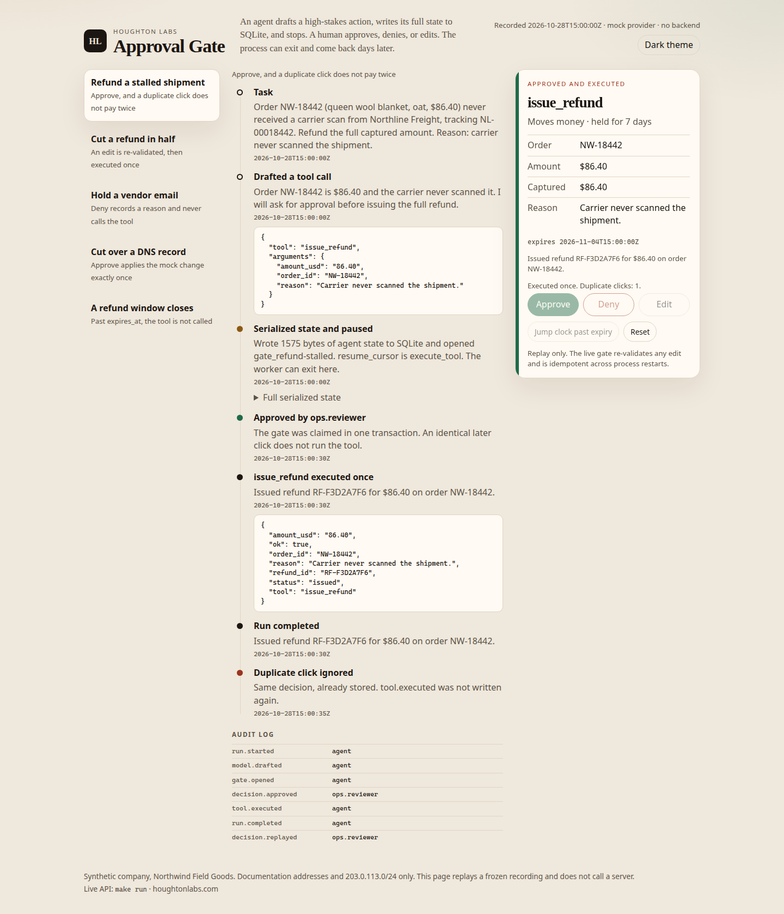
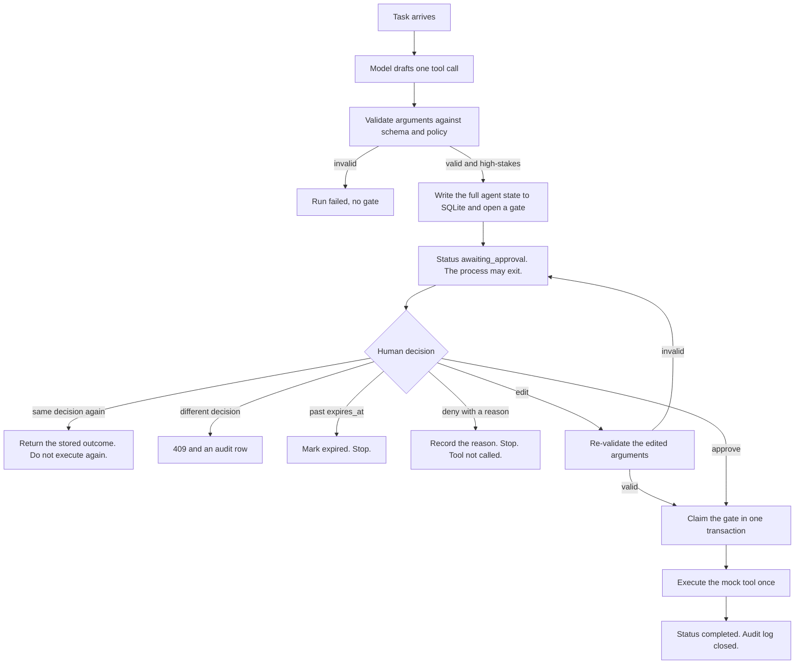
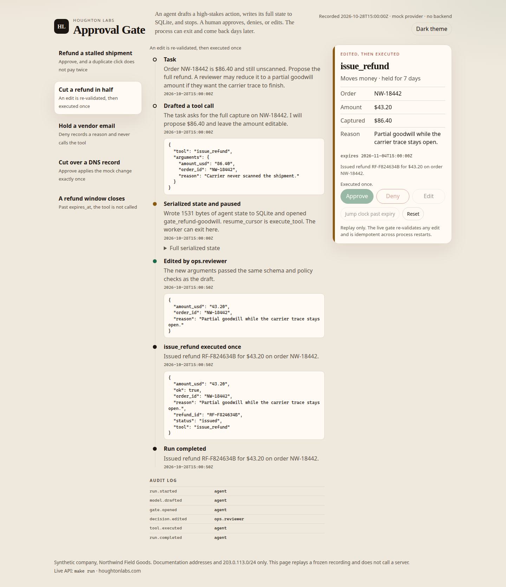
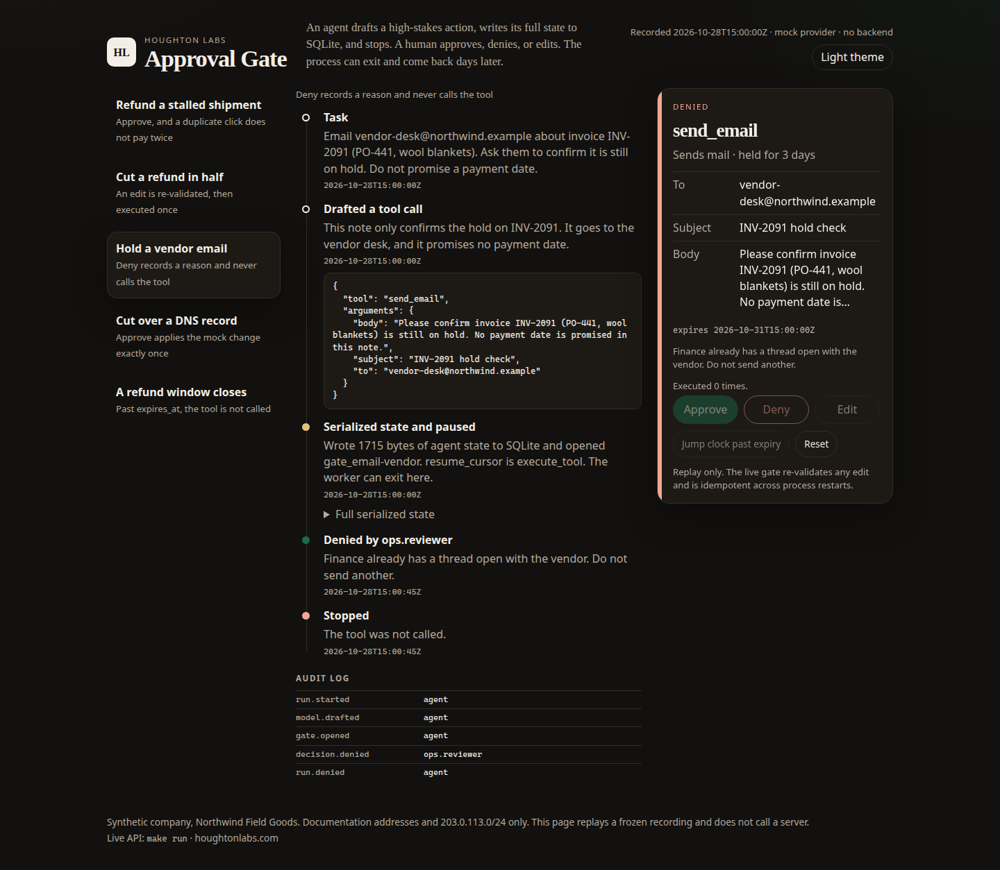

# Approval Gate

An agent drafts a high-stakes action, writes its full state to SQLite, and stops. A human approves, denies, or edits — minutes or days later, from a form or a Slack-style payload — and the same tool call resumes exactly once.

High-stakes tool calls should not sit inside a live model turn waiting on a person. Laptops sleep, workers get redeployed, and a reviewer may not answer until the next day. This demo treats approval as a durable pause. The process is free to exit. The decision is a row. A second click returns the recorded outcome and does not run the tool again.

**Live demo:** https://agent-approval-gate.pages.dev *(placeholder — not deployed yet)*



The static page replays a frozen recording. Approve, Deny, and Edit advance that recording. Nothing on the page calls a server, so it can be hosted as plain files.



## Quick start

```bash
make install        # FastAPI, Pydantic v2, pytest
make test           # unit tests, no API keys
make record         # regenerate site/data from the engine
make demo           # record, then serve site/ on :8088
make run            # live API and a small console on :8787
```

Open the static replay at <http://127.0.0.1:8088>, or the live console at <http://127.0.0.1:8787>. `HL_DATASET_URI` overrides the synthetic dataset directory (default `demo/data`). A `file://` URL also works: `site/index.html` loads `site/data/runs.js`, and an HTTP server prefers `site/data/runs.json`.

```bash
curl -s localhost:8787/v1/runs -H 'content-type: application/json' \
  -d '{"scenario_id":"refund-stalled"}'
curl -s localhost:8787/v1/runs/$RUN/decisions -H 'content-type: application/json' \
  -d '{"decision":"approve","actor":"ops.reviewer"}'
```

The second call with the same decision returns `"idempotent_replay": true` and leaves `tool_execution_count` at 1.

| Variable | Effect |
|---|---|
| `HL_DATASET_URI` | Dataset directory, or a `file://` URI. Default `demo/data`. |
| `HL_DB_PATH` | SQLite file. Default `var/gate.db`. |
| `HL_LLM_PROVIDER` | `mock` (default), `replay`, or `ollama`. |
| `HL_OLLAMA_URL` | Default `http://127.0.0.1:11434`. |
| `HL_OLLAMA_MODEL` | Default `qwen3:8b`. |
| `PORT` | Live API port. Default `8787`. |

## How it works



The pause is a row, not a sleeping thread. `resume_cursor` on the stored state is `execute_tool`. A new process opens the same SQLite file, applies the decision, and continues.

Claiming the gate and running the tool are two steps on purpose. The claim transaction flips the gate from `open` to `claimed` and the run to `executing`. If the process dies in that window, the next startup calls `recover()` and finishes the tool. The effect table has `UNIQUE(gate_id)`, and the mock tool is a pure function of the fixture data plus that gate id, so a retry writes the same ticket.

Money is a two-decimal string (`"86.40"`), not a float. Edits go through the same Pydantic models and the same policy as the original draft: the refund cannot exceed the captured total or the cap, mail can only go to a directory address, and a DNS change has to stay inside `203.0.113.0/24`. A rejected edit leaves the gate open.

Expiry is checked when a decision arrives and when `POST /v1/maintenance/expire` runs. It is not a thread blocked on a timer. Refunds in the sample policy stay open for 7 days, mail for 3 days, DNS for 4 hours. The cancelled-order scenario overrides that to 1 hour so the recording can show a late click.

Decisions arrive three ways, and all of them call the same function:

- `POST /v1/runs/{id}/decisions` or `POST /v1/gates/{id}/decisions` with JSON
- `POST /v1/hooks/slack` with an `application/x-www-form-urlencoded` field named `payload`, the shape Slack uses for interactive components
- `GET` and `POST /v1/gates/{id}/form`, a plain HTML form

`mock` follows the script in `demo/data/scenarios.json` and writes the final sentence from the tool result. `replay` serves `demo/data/replays.json`, including a final-sentence template. `ollama` posts to a local `/api/chat` with temperature 0 and seed 42. Tests and CI use `mock`.

## Sample run

Frozen clock, 28 Oct 2026 15:00:00Z, mock provider. Regenerate with `make record`.

| Scenario | Human decision | Outcome | Tool runs |
|---|---|---|---|
| Refund NW-18442, $86.40, 7-day gate | Approve, then the same Approve again | `RF-F3D2A7F6` issued for $86.40 | 1 |
| Same order, reviewer cuts it to $43.20 | Edit, re-validated | `RF-F824634B` issued for $43.20 | 1 |
| Email vendor-desk@northwind.example about INV-2091 | Deny with a reason | Stopped. No message id. | 0 |
| `shop.example.test` A `203.0.113.10` → `203.0.113.24` | Approve | `DNS-F549D43B` | 1 |
| Refund NW-17710, 1-hour gate | Approve after `expires_at` | 410 expired. Nothing issued. | 0 |





A resumed process loads the same JSON it wrote: system prompt, task, drafted tool call, `resume_cursor`, and gate id. The assistant message keeps the original draft. The gate row keeps that proposal separately from the arguments that were actually authorized, which is what the tool receives.

## Design decisions and tradeoffs

- **SQLite is the durability boundary.** One file is enough to show a real restart. Several app servers would want the same unique constraint in Postgres.
- **The claim commits before the tool runs.** A crash after the claim is recoverable. A slow model on the final sentence holds the write lock; the mock path is instant, and that tradeoff is acceptable here.
- **The mock tools do not change the world.** They return the ticket a refund API, mailer, or DNS provider would return. A real outbound call should send the gate id as its own idempotency key.
- **The default model is a script.** CI has nothing to phone. The Ollama provider is the same `complete()` seam, and it is not part of CI.
- **The public site is a recording.** Cloudflare Pages needs no Worker. The buttons cannot accept an edit that was never recorded. `make run` can.

## Caveats

- Every company, order, address, and IP in this repo is synthetic. Northwind Field Goods is fictional. Addresses are `.example` or `example.test`. DNS values are in the documentation range `203.0.113.0/24`.
- The form and the Slack endpoint do not authenticate the reviewer, and the Slack body is not signature-checked. Fine on localhost. Not fine on a network.
- Expiry changes state when a decision or the sweep runs. There is no clock daemon in the demo server.
- `ollama` is best-effort. If it is down, the draft fails and the run is marked failed. If it dies after a claim, the gate stays `executing` until `recover()`.
- The static page will replay one recorded edit. A different amount is a live-server concern.

## Layout

```
agent_gate/     engine, SQLite store, tools, providers, FastAPI, recorder
demo/data/      synthetic scenarios, orders, zones, directory, policy, replays
site/           static replay (index.html, assets, data/runs.json)
docs/images/    screenshots of the static site
tests/          pytest, including a real second process for restart
```

## Tests

```bash
make test
```

The suite covers approve, deny, edit, rejected edits, expiry, the sweep, Slack's form payload, the HTML form, duplicate decisions, the unique effect row, and a subprocess that exits after the pause and another that approves. No network and no model weights.

## License

MIT, see [LICENSE](LICENSE).

## Cloudflare Pages

Static site root: `site/`. Recorded runs: `site/data/runs.json` (also mirrored as `site/data/runs.js` so `file://` works). Source scenarios: `demo/data/`.

Suggested Pages project: **agent-approval-gate** · Production branch `main` · Framework none · Root directory `site` · no build command. See [wrangler.toml](wrangler.toml).
